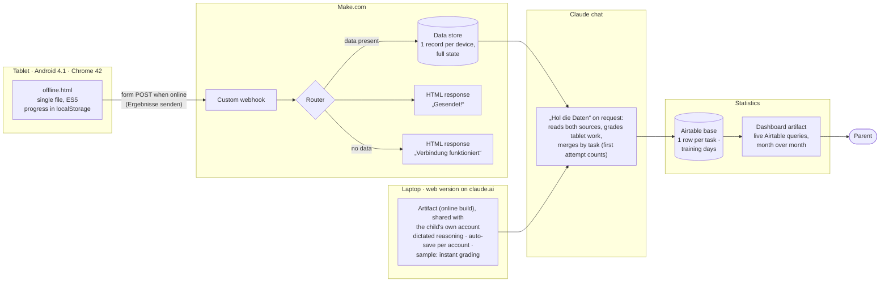

# Olympiade-Training

**A math olympiad trainer for a 10-year-old that runs where he actually learns: offline on a 2014 Android tablet (Chrome 42), and as a web version in the browser on a laptop, under his own Claude account.**

Two levels (school round and regional round) · staged hints instead of instant answers · a 20-minute focus timer · retries that never overwrite the first attempt · dictated explanations graded like the real olympiad (online) · gamified progress that rewards effort · results sync to the parent through Make.com and land in an Airtable base behind a month-over-month progress dashboard.

**Live demo:** https://dariiasichynska.github.io/olympiade-training/ (offline build with 9 demo tasks in two galaxies; the UI is in German, the language of the competition)


---

## The problem

A fifth-grader in Berlin was preparing for the German *Mathematik-Olympiade*. The setup:

- **Old hardware, often offline.** His only device is an ASUS Fonepad 7 from 2014: Android 4.1.2, Chrome 42, no updates available, frequently without internet.
- **The olympiad grades reasoning, not answers.** Every task sheet says *„Der Lösungsweg mit Begründungen und Nebenrechnungen soll deutlich erkennbar sein.“* In the official scoring schemes, a correct result without justification typically earns only **30–50 % of the points**; for logic puzzles the derivation can be worth 70 %.
- **A bilingual family.** The tasks are in German, but the parent wants to read them in Ukrainian at a glance. The child writes his explanations in German, his second language.
- **Motivation.** Olympiad tasks are hard. A plain test would frustrate a 10-year-old quickly.
- **Two places to learn.** The tablet for anywhere, a laptop with a microphone for longer sessions. The child should get the trainer on the laptop, but not access to the parent's whole AI account.
- **No visibility for the parent.** Which tasks did he solve, how long did it take, which hints did he need, and where are the actual gaps?

## The solution

| | |
|---|---|
|  |  |
| **Task view.** Original German text, figure, one-tap Ukrainian translation for the parent. | **Staged hints.** Hint 1 unlocks after 4 minutes of active thinking, hint 2 after 8 and hint 3 after 12, on the same clock as the 20-minute timer. Hint 3 lays out the full logic, leaving only the arithmetic. |
|  |  |
| **20 minutes per task.** A countdown bar on top with an encouraging message that changes as time runs out (blue → yellow → red). | **Time's up.** After 20 minutes a full-screen message asks what's next: take 5 more minutes (as often as needed), hand in what is there, or go to the next star. Skipped tasks stay open for later. |
|  |  |
| **Online: dictated reasoning that counts.** On a laptop the child speaks his *Lösungsweg* with the system's dictation (macOS: press Control twice; set this as the dictation shortcut, because the 🌐 key often opens the emoji picker), one field per part a), b), c), guided by four questions. It is graded like the olympiad: a correct result without justification earns a 4 at best. The grader ignores speech-recognition errors and numbers spoken as words. | **Offline: optional reasoning.** On the tablet, whose keyboard has no microphone, typing is the bottleneck, so the *Lösungsweg* is voluntary and the grade follows the answers. Sentence starters are inserted where the cursor is. |
|  |  |
| **One attempt counts, like the real competition.** Instant check of every answer field, a German school grade 1–6 and the model solution. | **Nochmal lösen (try again).** Any submitted task can be solved again. The last answers are pre-filled, the model solution stays hidden until the new hand-in, and the result is shown as a separate practice attempt. Grade and statistics keep the first attempt. |

**Further features**

- **Answer types that match olympiad tasks:** numbers, times, money in several units, assignment tables for logic puzzles, multiple choice, sets of numbers, sizes such as `3x7`, ordered sequences, arithmetic expressions with a fixed digit count (*„vier Achten“*), complete lists of arrangements (`LWB, LBW, …`) with feedback such as *„5 von 6 gefunden · doppelt: WLB“*, and self-check for drawing tasks.
- **Two galaxies, two levels.** *Galaxie 1* holds school-round tasks, *Galaxie 2* the harder regional round (2nd stage), each with its own map, progress counter and next-star logic. The demo has 6 + 3 tasks; the private version has 24 + 20 real tasks.
- **Werkstatt (workshop).** Short drills with instant feedback and unlimited retries, targeting the weaknesses the real submissions revealed: systematic enumeration, *finding all solutions and proving there are no more* (added for the regional round), operator precedence (*Punkt vor Strich*) and writing a justification.
  
- **Free choice of tasks.** Every star on the map can be opened. A *Nächster Stern* button skips ahead, so one hard task never blocks the rest.
- **Motivation that rewards effort, not only correctness.** Ranks, *Sternenstaub* (stardust) and 26 badges (doubled after the child asked for more), for example *Durchhalter* (used all hints and still finished), *Comeback* (good grade right after a bad one) and *Geduldiger Forscher* (10+ minutes of active thinking).
- **Honest time tracking.** Only active time counts: the page is visible and there was input within the last 10 minutes. A task left open for three days no longer reports 4,000 minutes.
- **Web version under the child's own account.** The online build is shared with the child's Claude account with *can use* access. He opens one bookmark and sees only the trainer, not the parent's chats. Progress saves automatically per account; existing progress was moved over once with the built-in import.
- **Parent view (online build).** Every submission with timestamps, hints used, answers, the full reasoning (typed or dictated), the rubric that graded it, the grade and a short note for the parent.
- **Statistics dashboard.** Tablet and laptop results end up in one Airtable base; a dashboard shows tasks, grades, active time, hints and success by topic, month over month.

## Architecture



**Two builds from one source**

| | `dist/offline.html` | `dist/artifact.html` |
|---|---|---|
| Runs on | any browser, incl. Chrome 42 / Android 4.1, from `file://` | a Claude artifact on claude.ai (web version in any current browser) |
| Access | the file on the device | shared with the child's own Claude account (*can use*), owner keeps the parent view |
| Storage | `localStorage`; full state uploaded on request | artifact database (`db`), per-user documents, owner-only parent view |
| Reasoning | optional, typed | dictated (system dictation), one field per part |
| Grading | later, by Claude in chat after the upload; answers only | immediately, from the page via the `sample` capability; answers and reasoning, olympiad rubric |
| Sync | **Ergebnisse senden** → Make webhook | read by Claude from the artifact database |

## How it was built — and my role

I am training as an *AI Manager / process automation* specialist (Make, n8n, BPMN). This project was a real need at home, and I ran it like a small product project. I worked with **Claude (Anthropic) as the developer**: Claude wrote most of the code; I owned the problem, the decisions, the testing and the automation.

1. **Requirements through structured questions.** Before anything was built, every open decision was settled through multiple-choice questions: task order (by difficulty), hint timing (5 minutes), one attempt vs. retries, grading scale (German 1–6), what is translated and what is not, how drawing tasks are handled, theme (a space cat — the child's own wish).
2. **Prototype → field test.** The first version worked on desktop but stayed blank on the tablet. Diagnosis: Chrome 42 cannot run modern JavaScript or CSS. Solution: a second, **legacy build pipeline** (Babel → ES5, minimal core-js polyfills, a separate CSS without custom properties/grid/`gap`, emoji replaced by glyphs old Android fonts contain), plus a start-up guard that prints the error and the browser version instead of a blank page.
3. **Second field issue: file viewers.** Android's built-in *HTML Viewer* and the iPhone file preview do not execute JavaScript. The file now explains this itself and shows how to open it in Chrome.
4. **Data-driven iteration.** After the first week, I analysed the child's real submissions with Claude. Three patterns stood out: incomplete enumeration (5 of 6 arrangements, 7 of 10), lost points through missing brackets, and explanations that said *what* was done but not *why*. Response: list-type answer fields with precise feedback, a reasoning scaffold, honest time tracking and the Werkstatt drills.
5. **Automation instead of copy-paste.** Moving results from an offline tablet by copying a JSON code was unusable in practice. I set up a **Make.com scenario** (webhook → router → data store → HTML response). The tablet sends a plain HTML form POST, which needs no CORS and works on Chrome 42. The response page doubles as the user's confirmation. Before rollout, I verified that Android 4.1 accepts the webhook's TLS certificate.
6. **Second iteration: remove friction.** The next round of real data showed two new problems. Typing explanations on a 7-inch tablet was the biggest obstacle, and single tasks often took 30–70 minutes. I changed three things. Written reasoning became optional, and the grading prompt now grades the answers and only rewards a good explanation. A 15-minute time box with a visible countdown and a full-screen *Zeit ist um!* prompts a decision (5 more minutes, hand in, or move on), and all tasks are open in any order. The hint schedule (4/8/12 minutes) now runs on the same active-time clock, so all three hints fit inside the time box. This is a deliberate trade-off against the competition's scoring: practice volume and motivation first, written justification as an optional extra.
7. **Bring the reasoning back, by voice.** Speaking is far easier for a 10-year-old than typing. The tablet's keyboard has no microphone, and claude.ai does not run on Chrome 42, so I added a second route: the online build on a laptop, where the child dictates his explanation. There the reasoning counts again, exactly as in the competition, while the tablet keeps the lighter rules. Both routes share one code base; a single flag switches the reasoning UI and the grading rubric, and every submission records which rubric graded it.
8. **Progress the parent can see.** I chose **Airtable** as the system of record: one row per task (status, dates, active time, hints, extra time, share of correct answers, grade, comment) and one row per training day. History survives a reset of the tablet, and the table can be filtered and annotated by hand. A **dashboard** reads Airtable live and shows the month's key figures with the change from the previous month, a month-by-month table, every grade over time, success by topic, and a searchable table of all tasks. Grades from before and after the rule change are labelled, so months stay comparable.
9. **Second level and a real web version.** After the school round, the trainer got a second galaxy for the regional round. Three requests came straight from the child and the data: more badges (they motivate him most), more time per task (15 → 20 minutes, still extendable), and a way to fix a task he now understands. *Nochmal lösen* keeps the olympiad rule (the first attempt counts) and still records every improvement separately, also in Airtable and the dashboard. Finally, the child moved from the parent's account to his own: the trainer is shared with his account only, his progress was migrated with the import function, and the offline file now carries a version number so old and new files never get mixed up.

## Technical notes

- **Single-file delivery.** Both builds are one self-contained HTML file: no server, no install, copy it to the tablet and open it in Chrome.
- **Legacy pipeline** (`scripts/build.js`): theme tokens are inlined, the code is transpiled to ES5 and minified, and only the 24 polyfill modules the app needs are bundled (≈66 KB instead of ≈750 KB). `npm run check:es5` verifies the output with `es-check`.
- **Exact arithmetic for expression answers.** Expressions such as `8 − (8 + 8) : 8` are parsed and evaluated with fractions, so `8 : 3 · 3` is never "almost 8".
- **Tests** (`npm test`) check that every model answer is accepted by the answer checker and that typical wrong answers produce the intended feedback.
- **Statistics.** The dashboard queries Airtable on each open with the viewer's own Airtable access; monthly figures and per-topic success are computed in the page from the task rows. Submitted tasks count in the month they were handed in, skipped ones in the month they were started.
- **Privacy by design.** No child data is in this repository, and no Airtable IDs or dashboard links. The webhook URL is injected at build time (`UPLOAD_URL`) and never committed. Without it, the upload button is hidden.

## Run it

```bash
npm install
npm test                 # checks all demo tasks and drills
npm run build            # → dist/artifact.html, dist/offline.html, docs/index.html
npm run check:es5        # verifies the legacy build is pure ES5

# with results upload (Make webhook):
UPLOAD_URL="https://hook.eu1.make.com/…" DEVICE_ID="tablet-1" npm run build
```

**On an old Android tablet:** copy `dist/offline.html` to the *Download* folder, open **Chrome** and enter `file:///sdcard/`, then tap the folder and the file. Bookmark it, because progress is stored per file address. To reset all progress, open the same address with `#reset` at the end.

**As a Claude artifact:** publish `dist/artifact.html` as an artifact with the capabilities `db`, `user`, `sample` and `downloads`. Share it with the child's Claude account with at least *can use* access (a pure view role cannot save). Progress is stored per account; to move existing progress, export it in one place and use *Stand importieren* in the other.

## Make.com setup

1. Create a data structure as in [`make/data-structure.json`](make/data-structure.json) and a data store using it.
2. Create a custom webhook.
3. Import [`make/scenario-blueprint.json`](make/scenario-blueprint.json), select your webhook and data store (replace the `<YOUR_…>` placeholders), and activate the scenario with scheduling *immediately*.
4. Build with `UPLOAD_URL` set to the webhook address. Open the address once on the target device: it should answer *„Verbindung funktioniert“*.

## Content and copyright

The nine tasks in this repository are **original demo tasks written for this project** in the style of the competition. The real olympiad tasks are © Aufgabenausschuss für die Mathematik-Olympiade in Deutschland (all rights reserved) and are therefore **not included**. This project is not affiliated with the Mathematik-Olympiade.

## Changelog

**1.4.0 (2026-11-10)**
- Web version: the online build runs under the child's own Claude account (shared artifact); per-account auto-save, owner-only parent view, database copies take precedence over stale local copies.
- Two galaxies: school round and regional round, each with its own map, counter and next-star logic; demo tasks 7–9 belong to the regional round.
- *Nochmal lösen*: retry any submitted task with pre-filled answers and hidden model solution; first attempt stays graded, retries are stored and shown separately (online retries are graded too).
- Timer 20 minutes (was 15), hints unchanged at 4/8/12 minutes.
- 13 new badges (26 in total); badges are also checked on start, so earned ones appear right away.
- Werkstatt: new station *Alle finden – keine vergessen* (10 drills on complete enumeration and proving that no solutions are missing).
- Offline file names carry a version number.

**1.3.0 (2026-11-03)**
- Online build: dictated reasoning with one field per part, guiding questions and a dictation hint; reasoning is graded with the olympiad rubric, with tolerance for speech-recognition errors. A missing explanation triggers a warning, not a block.
- Offline build unchanged: reasoning stays optional, grading by answers.
- Every submission records which rubric graded it and whether it was dictated.
- Statistics: Airtable base (tasks, training days) and a dashboard with month-over-month figures.

**1.2.0 (2026-11-03)**
- The time box is softer: *Noch 5 Minuten* adds 5 minutes and can be used any number of times; it is now the first button on the *Zeit ist um!* screen.
- Active time no longer counts while the *Zeit ist um!* screen is open.

**1.1.0 (2026-10-29)**
- Written reasoning is optional; grading is based on the answers, a good explanation can raise the grade.
- 15-minute timer per task with motivating messages and a full-screen *Zeit ist um!* (next task, hand in, or 2 extra minutes once).
- All tasks unlocked; *Nächster Stern* button; skipped tasks stay open.
- Hints after 4, 8 and 12 minutes of active time (before: 5 minutes after the start and after each previous hint).
- Sentence starters are inserted at the cursor position instead of at the end.
- Badge *Geduldiger Forscher* now needs 10 minutes instead of 15.

**1.0.0 (2026-10-25)**
- First public version: offline and artifact builds, 9 demo tasks, Werkstatt, Make.com upload.

## License

[MIT](LICENSE) © 2026 Dariia Sichynska
