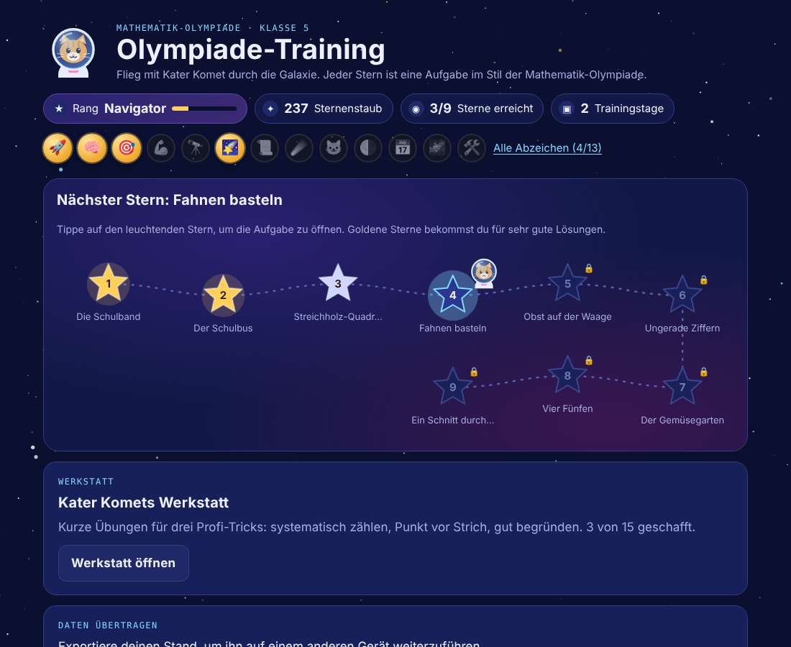
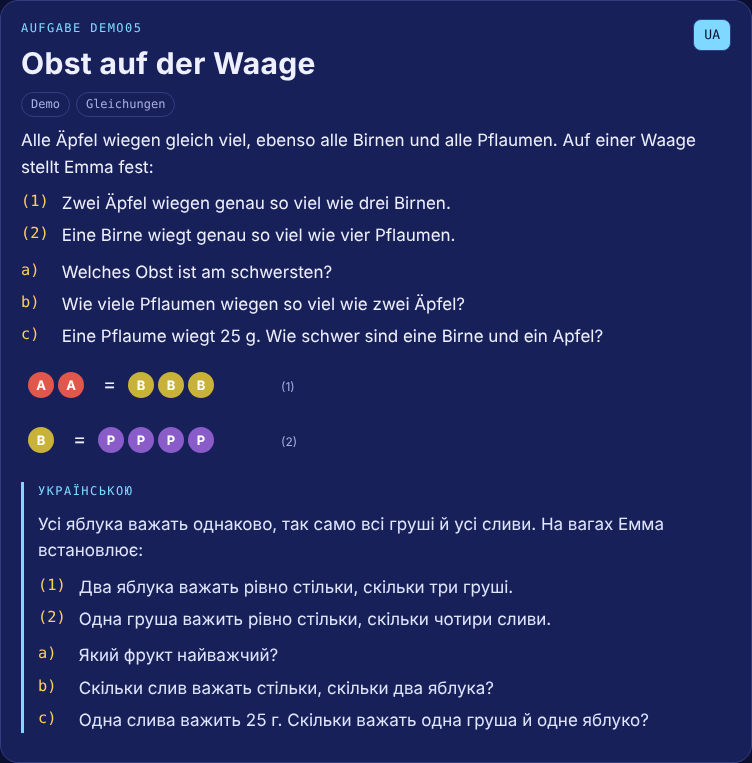
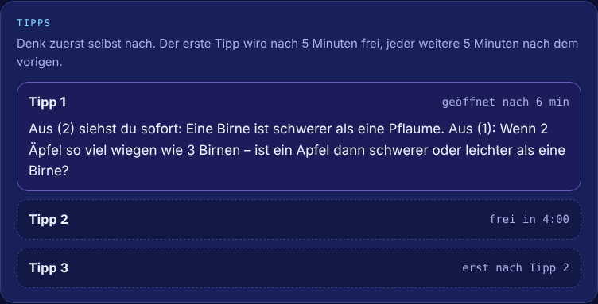
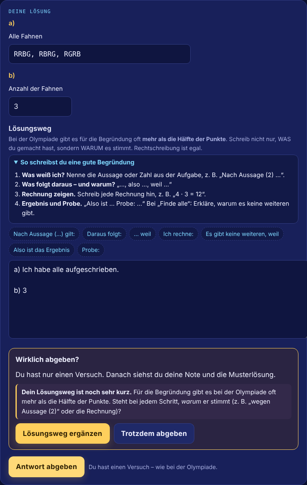
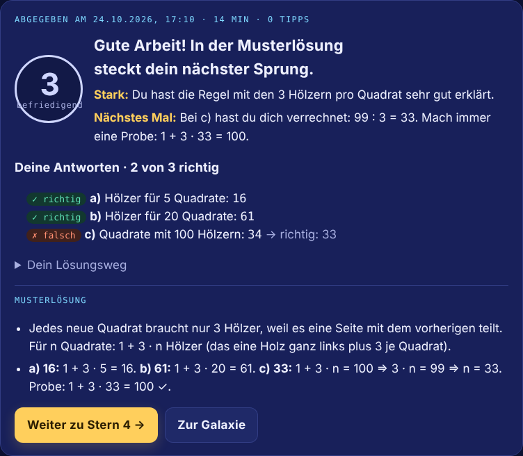
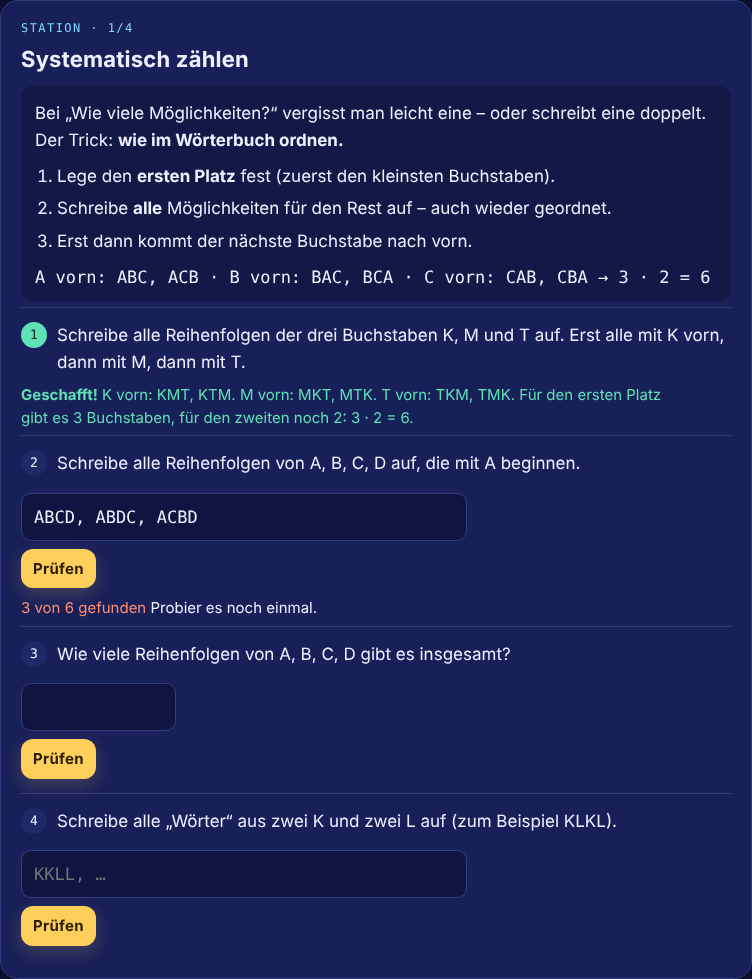
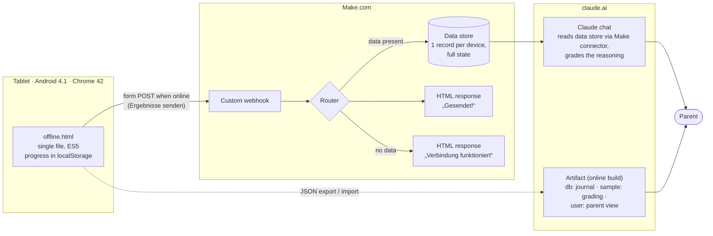

# Olympiade-Training

**An offline-first math olympiad trainer for a 10-year-old, built for the device he actually has: a 2014 Android tablet running Chrome 42.**

Staged hints instead of instant answers · AI-graded written reasoning · gamified progress that rewards effort · results sync to the parent through a Make.com webhook as soon as the tablet is online.

**Live demo:** https://dariiasichynska.github.io/olympiade-training/ (offline build with 9 demo tasks; the UI is in German, the language of the competition)



---

## The problem

A fifth-grader in Berlin was preparing for the German *Mathematik-Olympiade*. The setup:

- **Old hardware, often offline.** His only device is an ASUS Fonepad 7 from 2014: Android 4.1.2, Chrome 42, no updates available, frequently without internet.
- **The olympiad grades reasoning, not answers.** Every task sheet says *„Der Lösungsweg mit Begründungen und Nebenrechnungen soll deutlich erkennbar sein.“* In the official scoring schemes, a correct result without justification typically earns only **30–50 % of the points**; for logic puzzles the derivation can be worth 70 %.
- **A bilingual family.** The tasks are in German, but the parent wants to read them in Ukrainian at a glance. The child writes his explanations in German, his second language.
- **Motivation.** Olympiad tasks are hard. A plain test would frustrate a 10-year-old quickly.
- **No visibility for the parent.** Which tasks did he solve, how long did it take, which hints did he need, and where are the actual gaps?

## The solution

| | |
|---|---|
|  |  |
| **Task view.** Original German text, figure, one-tap Ukrainian translation for the parent. | **Staged hints.** Hint 1 unlocks after 5 minutes of thinking, each further hint 5 minutes later. Hint 3 lays out the full logic, leaving only the arithmetic. |
|  |  |
| **Reasoning trainer.** Answer fields plus a mandatory written *Lösungsweg* with sentence starters, a 4-step checklist and a soft warning when the explanation says *what* but not *why*. | **One attempt, like the real competition.** Instant check of every answer field, a German school grade 1–6 for the reasoning (Claude, online), and the model solution. |

**Further features**

- **Answer types that match olympiad tasks:** numbers, times, money in several units, assignment tables for logic puzzles, multiple choice, sets of numbers, sizes such as `3x7`, ordered sequences, arithmetic expressions with a fixed digit count (*„vier Achten“*), complete lists of arrangements (`LWB, LBW, …`) with feedback such as *„5 von 6 gefunden · doppelt: WLB“*, and self-check for drawing tasks.
- **Werkstatt (workshop).** Short drills with instant feedback and unlimited retries, targeting the three weaknesses the real submissions revealed: systematic enumeration, operator precedence (*Punkt vor Strich*) and writing a justification.
  
- **Motivation that rewards effort, not only correctness.** Ranks, *Sternenstaub* (stardust) and 13 badges, for example *Durchhalter* (used all hints and still finished), *Comeback* (good grade right after a bad one) and *Geduldiger Forscher* (15+ minutes of active thinking).
- **Honest time tracking.** Only active time counts: the page is visible and there was input within the last 10 minutes. A task left open for three days no longer reports 4,000 minutes.
- **Parent view (online build).** Every submission with timestamps, hints used, answers, the full written reasoning, the grade and a short note for the parent.

## Architecture



**Two builds from one source**

| | `dist/offline.html` | `dist/artifact.html` |
|---|---|---|
| Runs on | any browser, incl. Chrome 42 / Android 4.1, from `file://` | a Claude artifact on claude.ai |
| Storage | `localStorage` | artifact database (`db`), per-user documents, owner-only parent view |
| Grading | later, by Claude in chat after the upload | immediately, from the page via the `sample` capability |
| Sync | **Ergebnisse senden** → Make webhook | import of the tablet's JSON export |

## How it was built — and my role

I am training as an *AI Manager / process automation* specialist (Make, n8n, BPMN). This project was a real need at home, and I ran it like a small product project. I worked with **Claude (Anthropic) as the developer**: Claude wrote most of the code; I owned the problem, the decisions, the testing and the automation.

1. **Requirements through structured questions.** Before anything was built, every open decision was settled through multiple-choice questions: task order (by difficulty), hint timing (5 minutes), one attempt vs. retries, grading scale (German 1–6), what is translated and what is not, how drawing tasks are handled, theme (a space cat — the child's own wish).
2. **Prototype → field test.** The first version worked on desktop but stayed blank on the tablet. Diagnosis: Chrome 42 cannot run modern JavaScript or CSS. Solution: a second, **legacy build pipeline** (Babel → ES5, minimal core-js polyfills, a separate CSS without custom properties/grid/`gap`, emoji replaced by glyphs old Android fonts contain), plus a start-up guard that prints the error and the browser version instead of a blank page.
3. **Second field issue: file viewers.** Android's built-in *HTML Viewer* and the iPhone file preview do not execute JavaScript. The file now explains this itself and shows how to open it in Chrome.
4. **Data-driven iteration.** After the first week, I analysed the child's real submissions with Claude. Three patterns stood out: incomplete enumeration (5 of 6 arrangements, 7 of 10), lost points through missing brackets, and explanations that said *what* was done but not *why*. Response: list-type answer fields with precise feedback, a reasoning scaffold, honest time tracking and the Werkstatt drills.
5. **Automation instead of copy-paste.** Moving results from an offline tablet by copying a JSON code was unusable in practice. I set up a **Make.com scenario** (webhook → router → data store → HTML response). The tablet sends a plain HTML form POST, which needs no CORS and works on Chrome 42. The response page doubles as the user's confirmation. Before rollout, I verified that Android 4.1 accepts the webhook's TLS certificate.

## Technical notes

- **Single-file delivery.** Both builds are one self-contained HTML file: no server, no install, copy it to the tablet and open it in Chrome.
- **Legacy pipeline** (`scripts/build.js`): theme tokens are inlined, the code is transpiled to ES5 and minified, and only the 24 polyfill modules the app needs are bundled (≈66 KB instead of ≈750 KB). `npm run check:es5` verifies the output with `es-check`.
- **Exact arithmetic for expression answers.** Expressions such as `8 − (8 + 8) : 8` are parsed and evaluated with fractions, so `8 : 3 · 3` is never "almost 8".
- **Tests** (`npm test`) check that every model answer is accepted by the answer checker and that typical wrong answers produce the intended feedback.
- **Privacy by design.** No child data is in this repository. The webhook URL is injected at build time (`UPLOAD_URL`) and never committed. Without it, the upload button is hidden.

## Run it

```bash
npm install
npm test                 # checks all demo tasks and drills
npm run build            # → dist/artifact.html, dist/offline.html, docs/index.html
npm run check:es5        # verifies the legacy build is pure ES5

# with results upload (Make webhook):
UPLOAD_URL="https://hook.eu1.make.com/…" DEVICE_ID="tablet-1" npm run build
```

**On an old Android tablet:** copy `dist/offline.html` to the *Download* folder, open **Chrome** and enter `file:///sdcard/`, then tap the folder and the file. Bookmark it, because progress is stored per file address. To reset all progress, open the same address with `#reset` at the end.

**As a Claude artifact:** publish `dist/artifact.html` as an artifact with the capabilities `db`, `user`, `sample` and `downloads`. Share it with the child's Claude account with at least *can use* access.

## Make.com setup

1. Create a data structure as in [`make/data-structure.json`](make/data-structure.json) and a data store using it.
2. Create a custom webhook.
3. Import [`make/scenario-blueprint.json`](make/scenario-blueprint.json), select your webhook and data store (replace the `<YOUR_…>` placeholders), and activate the scenario with scheduling *immediately*.
4. Build with `UPLOAD_URL` set to the webhook address. Open the address once on the target device: it should answer *„Verbindung funktioniert“*.

## Content and copyright

The nine tasks in this repository are **original demo tasks written for this project** in the style of the competition. The real olympiad tasks are © Aufgabenausschuss für die Mathematik-Olympiade in Deutschland (all rights reserved) and are therefore **not included**. This project is not affiliated with the Mathematik-Olympiade.

## License

[MIT](LICENSE) © 2026 Dariia Sichynska
