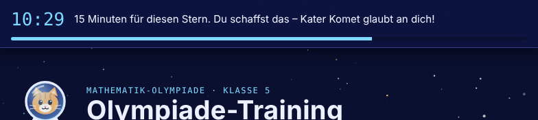
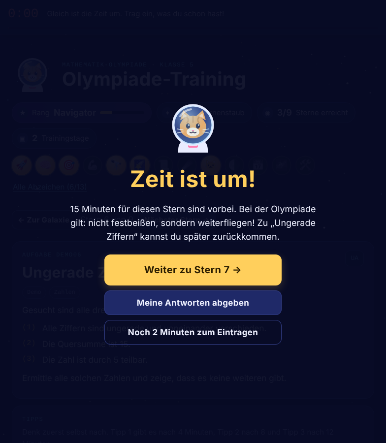
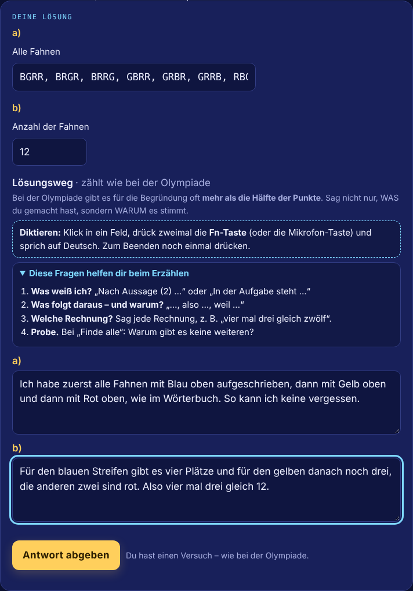
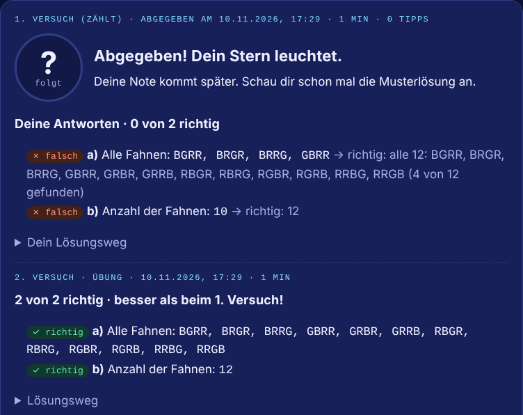

# Olympiade-Training

**A math olympiad trainer for a 10-year-old that is run where the child actually learns: offline on a 2014 Android tablet (Chrome 42) and as a web version in the browser on a laptop, under the child's own account on claude.ai.**

Two levels (school round and regional round) are covered. Staged hints are given instead of instant answers, a 20-minute focus timer is used, and retries never overwrite the first attempt. Dictated explanations are graded like in the real olympiad (online), and progress is rewarded for effort. Results are synchronised to the parent through Make.com and stored in an Airtable base behind a month-over-month progress dashboard.

**Live demo:** https://dariiasichynska.github.io/olympiade-training/ (offline build with 9 demo tasks in two galaxies; the interface is in German, the language of the competition)


---

## The problem

A fifth-grader in Berlin was preparing for the German *Mathematik-Olympiade*. The following conditions applied:

- **Old hardware, often offline.** Only one device is available: an ASUS Fonepad 7 from 2014 with Android 4.1.2 and Chrome 42. No updates are available, and the device is often used without internet.
- **Reasoning is graded, not only answers.** Every task sheet states: *„Der Lösungsweg mit Begründungen und Nebenrechnungen soll deutlich erkennbar sein.“* In the official scoring schemes, a correct result without justification typically earns only **30–50 % of the points**; for logic puzzles, the derivation can be worth 70 %.
- **A bilingual family.** The tasks are written in German, but they are to be read in Ukrainian by the parent at a glance. The explanations are written by the child in German, his second language.
- **Motivation.** Olympiad tasks are hard, and a plain test would quickly frustrate a 10-year-old.
- **Two places to learn.** The tablet is used anywhere, a laptop with a microphone for longer sessions. The trainer is to be available on the laptop without access to the parent's whole AI account.
- **No visibility for the parent.** It was not visible which tasks were solved, how long they took, which hints were needed and where the actual gaps are.

## The solution

| | |
|---|---|
|  |  |
| **Task view.** The original German text and the figure are shown; a Ukrainian translation for the parent is opened with one tap. | **Staged hints.** Hint 1 is unlocked after 4 minutes of active thinking, hint 2 after 8 and hint 3 after 12, on the same clock as the 20-minute timer. In hint 3, the full logic is laid out, and only the arithmetic is left. |
|  |  |
| **20 minutes per task.** A countdown bar is shown at the top, with an encouraging message that changes as time runs out (blue → yellow → red). | **Time's up.** After 20 minutes, a full-screen message is shown: 5 more minutes can be taken (as often as needed), the current state can be handed in, or the next star can be opened. Skipped tasks are kept open. |
|  |  |
| **Online: dictated reasoning that counts.** On a laptop, the *Lösungsweg* is spoken with the system dictation (macOS: Control is pressed twice; this is set as the dictation shortcut, because the 🌐 key often opens the emoji picker), one field per part a), b), c), guided by four questions. The reasoning is graded like in the olympiad: a correct result without justification earns a 4 at best. Speech-recognition errors and numbers spoken as words are ignored by the grader. | **Offline: optional reasoning.** On the tablet, no microphone is available on the keyboard, and typing is the bottleneck. Therefore the *Lösungsweg* is voluntary, and the grade is based on the answers. Sentence starters are inserted at the cursor position. |
|  |  |
| **One attempt counts, like in the real competition.** Every answer field is checked instantly; a German school grade (1–6) and the model solution are shown. | **Nochmal lösen (solve again).** Any submitted task can be solved again. The last answers are pre-filled, the model solution is hidden until the new hand-in, and the result is shown as a separate practice attempt. The first attempt is kept in the grade and the statistics. |

**Further features**

- **Answer types that match olympiad tasks** are supported: numbers, times, money in several units, assignment tables for logic puzzles, multiple choice, sets of numbers, sizes such as `3x7`, ordered sequences, arithmetic expressions with a fixed digit count (*„vier Achten“*), complete lists of arrangements (`LWB, LBW, …`) with feedback such as *„5 von 6 gefunden · doppelt: WLB“*, and self-check for drawing tasks.
- **Two galaxies, two levels.** School-round tasks are placed in *Galaxie 1*, the harder regional round (2nd stage) in *Galaxie 2*; each galaxy has its own map, progress counter and next-star logic. The demo contains 6 + 3 tasks; the private version contains 24 + 20 real tasks.
- **Werkstatt (workshop).** Short drills with instant feedback and unlimited retries are provided for the weaknesses that were found in the real submissions: systematic enumeration, *finding all solutions and proving that there are no more* (added for the regional round), operator precedence (*Punkt vor Strich*) and writing a justification.
  
- **Free choice of tasks.** Every star on the map can be opened. With the *Nächster Stern* button, a task can be skipped, so that one hard task never blocks the rest.
- **Motivation that rewards effort, not only correctness.** Ranks, *Sternenstaub* (stardust) and 26 badges are awarded (the number was doubled at the child's request), for example *Durchhalter* (all hints used and the task still finished), *Comeback* (a good grade right after a bad one) and *Geduldiger Forscher* (10+ minutes of active thinking).
- **Honest time tracking.** Only active time is counted: the page is visible, and input was made within the last 10 minutes. A task that is left open for three days no longer reports 4,000 minutes.
- **Web version under the child's own account.** The online build is shared with the child's account with *can use* access. Only the trainer is visible to the child, not the parent's chats. Progress is saved automatically per account; existing progress was moved once with the built-in import.
- **Parent view (online build).** Every submission is shown with timestamps, hints used, answers, the full reasoning (typed or dictated), the rubric that was used for grading, the grade and a short note for the parent.
- **Statistics dashboard.** Results from the tablet and the laptop are stored in one Airtable base; tasks, grades, active time, hints and success by topic are shown month over month in a dashboard.

## Architecture


**Two builds from one source**

| | `dist/offline.html` | `dist/artifact.html` |
|---|---|---|
| Runs on | any browser, incl. Chrome 42 / Android 4.1, from `file://` | a Claude artifact on claude.ai (web version in any current browser) |
| Access | the file on the device | shared with the child's own account (*can use*); the parent view is kept by the owner |
| Storage | `localStorage`; the full state is uploaded on request | artifact database (`db`), per-user documents, owner-only parent view |
| Reasoning | optional, typed | dictated (system dictation), one field per part |
| Grading | later, in the Claude chat after the upload; answers only | immediately, from the page via the `sample` capability; answers and reasoning, olympiad rubric |
| Sync | **Ergebnisse senden** → Make webhook | read from the artifact database in the Claude chat |

## Project background

The project was started for a real need at home and was run as a small product project.

Problem, decisions, testing and automation: Dariia Sichynska.

Tools: Claude (Anthropic), Make.com, Airtable, JavaScript (ES5 build with Babel), GitHub Pages.

1. **Requirements through structured questions.** Before anything was built, every open decision was settled through multiple-choice questions: task order (by difficulty), hint timing (5 minutes), one attempt or retries, grading scale (German 1–6), what is translated and what is not, how drawing tasks are handled, and the theme (a space cat, as requested by the child).
2. **Prototype and field test.** The first version worked on the desktop but stayed blank on the tablet. The cause was found: modern JavaScript and CSS cannot be run by Chrome 42. A second **legacy build pipeline** was added (Babel → ES5, minimal core-js polyfills, a separate CSS without custom properties, grid or `gap`, emoji replaced by glyphs that are contained in old Android fonts), together with a start-up guard that shows the error and the browser version instead of a blank page.
3. **Second field issue: file viewers.** JavaScript is not executed by the built-in Android *HTML Viewer* or by the iPhone file preview. This is now explained in the file itself, and the way to open it in Chrome is shown.
4. **Data-driven iteration.** After the first week, the real submissions were analysed. Three patterns were found: incomplete enumeration (5 of 6 arrangements, 7 of 10), points lost through missing brackets, and explanations that said *what* was done but not *why*. As a response, list-type answer fields with precise feedback, a reasoning scaffold, honest time tracking and the Werkstatt drills were added.
5. **Automation instead of copy-paste.** Copying results as a JSON code from an offline tablet proved unusable in practice. A **Make.com scenario** was set up (webhook → router → data store → HTML response). A plain HTML form POST is sent by the tablet; no CORS is needed, and it works on Chrome 42. The response page is also used as the confirmation for the user. Before rollout, it was verified that the TLS certificate of the webhook is accepted by Android 4.1.
6. **Second iteration: friction removed.** Two new problems were found in the next round of real data: typing explanations on a 7-inch tablet was the biggest obstacle, and single tasks often took 30–70 minutes. Three changes were made. Written reasoning was made optional, and the answers are graded, while a good explanation is only rewarded. A 15-minute time box with a visible countdown and a full-screen *Zeit ist um!* was introduced (5 more minutes, hand in, or move on), and all tasks were opened in any order. The hint schedule (4/8/12 minutes) is run on the same active-time clock, so all three hints fit inside the time box. This is a deliberate trade-off against the scoring of the competition: practice volume and motivation come first, written justification is an optional extra.
7. **Reasoning brought back by voice.** Speaking is far easier than typing for a 10-year-old. No microphone is available on the tablet keyboard, and claude.ai cannot be run on Chrome 42. Therefore a second route was added: the online build on a laptop, where the explanation is dictated. There the reasoning counts again, as in the competition, while the lighter rules are kept on the tablet. One code base is shared by both routes; the reasoning interface and the grading rubric are switched by a single flag, and the rubric that was used is recorded with every submission.
8. **Progress visible to the parent.** **Airtable** was chosen as the system of record: one row per task (status, dates, active time, hints, extra time, share of correct answers, grade, comment) and one row per training day. The history is kept after a reset of the tablet, and the table can be filtered and annotated by hand. Airtable is read live by a **dashboard**, in which the key figures of the month with the change from the previous month, a month-by-month table, every grade over time, success by topic and a searchable table of all tasks are shown. Grades from before and after the rule change are labelled, so that months stay comparable.
9. **Second level and a real web version.** After the school round, a second galaxy was added for the regional round. Three requests came directly from the child and from the data: more badges (they are the strongest motivation), more time per task (15 → 20 minutes, still extendable) and a way to correct a task that is now understood. With *Nochmal lösen*, the olympiad rule is kept (the first attempt counts), and every improvement is still recorded separately, also in Airtable and in the dashboard. Finally, the trainer was moved from the parent's account to the child's own account: it is shared with that account only, the progress was migrated with the import function, and a version number was added to the offline file, so that old and new files are never mixed up.

## Technical notes

- **Single-file delivery.** Each build is one self-contained HTML file. No server and no installation are needed; the file is copied to the tablet and opened in Chrome.
- **Legacy pipeline** (`scripts/build.js`): theme tokens are inlined, the code is transpiled to ES5 and minified, and only the 24 polyfill modules that are needed are bundled (≈66 KB instead of ≈750 KB). The output is verified with `es-check` (`npm run check:es5`).
- **Exact arithmetic for expression answers.** Expressions such as `8 − (8 + 8) : 8` are parsed and evaluated with fractions, so `8 : 3 · 3` is never "almost 8".
- **Tests** (`npm test`): it is checked that every model answer is accepted by the answer checker and that typical wrong answers produce the intended feedback.
- **Statistics.** Airtable is queried by the dashboard each time it is opened, with the viewer's own Airtable access; monthly figures and success by topic are computed in the page from the task rows. Submitted tasks are counted in the month in which they were handed in, skipped tasks in the month in which they were started.
- **Privacy by design.** No child data, no Airtable IDs and no dashboard links are contained in this repository. The webhook URL is injected at build time (`UPLOAD_URL`) and is never committed. Without it, the upload button is hidden.

## Build

```bash
npm install
npm test                 # all demo tasks and drills are checked
npm run build            # → dist/artifact.html, dist/offline.html, docs/index.html
npm run check:es5        # the legacy build is verified as pure ES5

# with results upload (Make webhook):
UPLOAD_URL="https://hook.eu1.make.com/…" DEVICE_ID="tablet-1" npm run build
```

**On an old Android tablet:** `dist/offline.html` is copied to the *Download* folder. In **Chrome**, `file:///sdcard/` is entered, and the folder and the file are opened. The page is bookmarked, because progress is stored per file address. All progress is reset when the same address is opened with `#reset` at the end.

**As a Claude artifact:** `dist/artifact.html` is published as an artifact with the capabilities `db`, `user`, `sample` and `downloads`. It is shared with the child's account with at least *can use* access (progress cannot be saved with a pure view role). Progress is stored per account; existing progress is moved by an export in one place and *Stand importieren* in the other.

## Make.com set-up

1. A data structure is created as in [`make/data-structure.json`](make/data-structure.json), and a data store is created with it.
2. A custom webhook is created.
3. [`make/scenario-blueprint.json`](make/scenario-blueprint.json) is imported, the webhook and the data store are selected (the `<YOUR_…>` placeholders are replaced), and the scenario is activated with the scheduling *immediately*.
4. The build is run with `UPLOAD_URL` set to the webhook address. When the address is opened once on the target device, *„Verbindung funktioniert“* is returned.

## Content and copyright

The nine tasks in this repository are **original demo tasks that were written for this project** in the style of the competition. The real olympiad tasks are © Aufgabenausschuss für die Mathematik-Olympiade in Deutschland (all rights reserved) and are therefore **not included**. This project is not affiliated with the Mathematik-Olympiade.

## Changelog

**1.4.1 (2026-11-13)**
- The README was rewritten in an impersonal, passive style. The code was not changed.

**1.4.0 (2026-11-10)**
- Web version: the online build is run under the child's own account (shared artifact). Progress is saved automatically per account, the parent view is visible to the owner only, and database copies take precedence over stale local copies.
- Two galaxies were added: school round and regional round, each with its own map, counter and next-star logic. Demo tasks 7–9 belong to the regional round.
- *Nochmal lösen*: any submitted task can be solved again with pre-filled answers and a hidden model solution. The first attempt stays graded; retries are stored and shown separately (online retries are graded as well).
- The timer was set to 20 minutes (before: 15); the hints are unchanged at 4/8/12 minutes.
- 13 new badges were added (26 in total). Badges are also checked at start, so that earned badges are shown at once.
- Werkstatt: the station *Alle finden – keine vergessen* was added (10 drills on complete enumeration and on proving that no solutions are missing).
- A version number was added to the names of offline files.

**1.3.0 (2026-11-03)**
- Online build: dictated reasoning was added, with one field per part, guiding questions and a dictation hint. The reasoning is graded with the olympiad rubric, and speech-recognition errors are tolerated. A missing explanation triggers a warning, not a block.
- The offline build was not changed: reasoning stays optional, and the grade is based on the answers.
- The rubric that was used and whether the reasoning was dictated are recorded with every submission.
- Statistics: an Airtable base (tasks, training days) and a dashboard with month-over-month figures were added.

**1.2.0 (2026-11-03)**
- The time box was softened: *Noch 5 Minuten* adds 5 minutes and can be used any number of times; it is now shown as the first button on the *Zeit ist um!* screen.
- Active time is no longer counted while the *Zeit ist um!* screen is open.

**1.1.0 (2026-10-29)**
- Written reasoning was made optional. The grade is based on the answers; a good explanation can raise the grade.
- A 15-minute timer per task was added, with motivating messages and a full-screen *Zeit ist um!* (next task, hand in, or 2 extra minutes once).
- All tasks were unlocked, a *Nächster Stern* button was added, and skipped tasks are kept open.
- Hints are given after 4, 8 and 12 minutes of active time (before: 5 minutes after the start and after each previous hint).
- Sentence starters are inserted at the cursor position instead of at the end.
- The badge *Geduldiger Forscher* now requires 10 minutes instead of 15.

**1.0.0 (2026-10-25)**
- First public version: offline and artifact builds, 9 demo tasks, Werkstatt and Make.com upload.

## License

[MIT](LICENSE) © 2026 Dariia Sichynska
